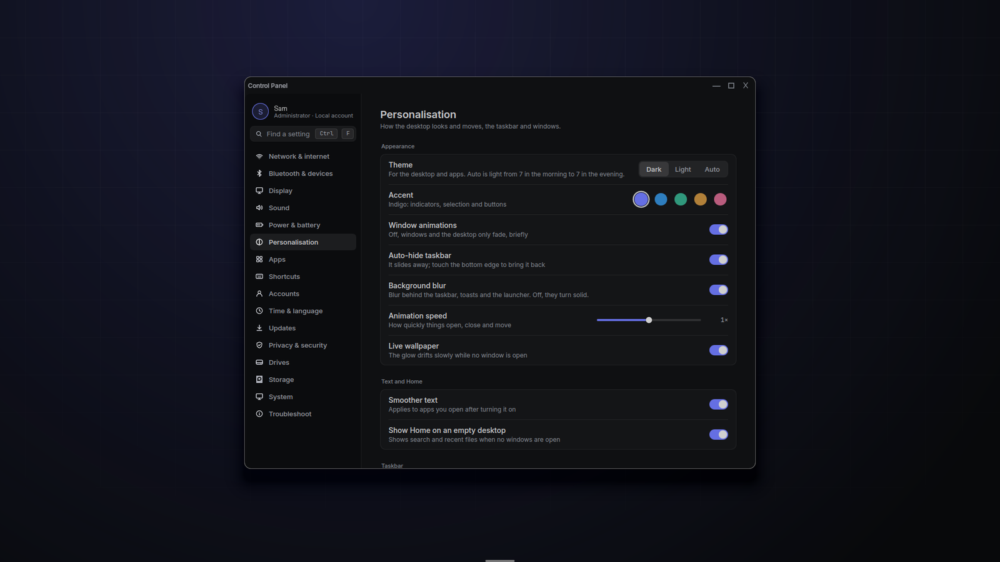
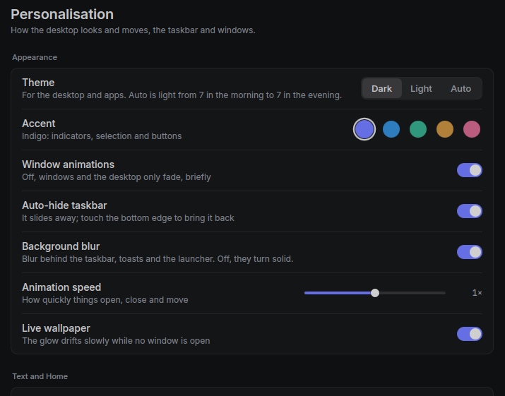
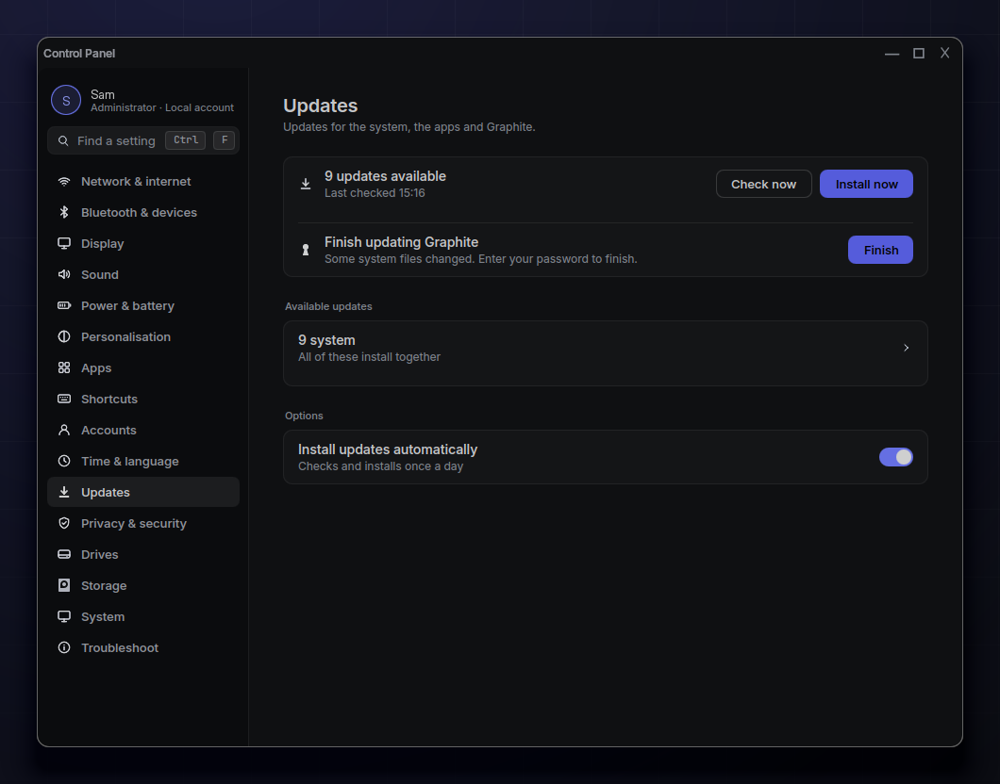
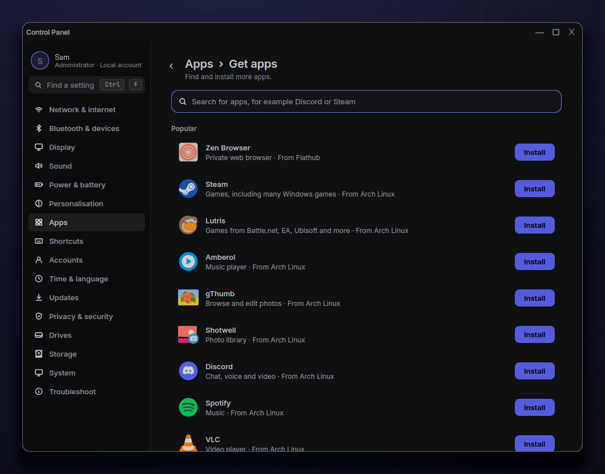
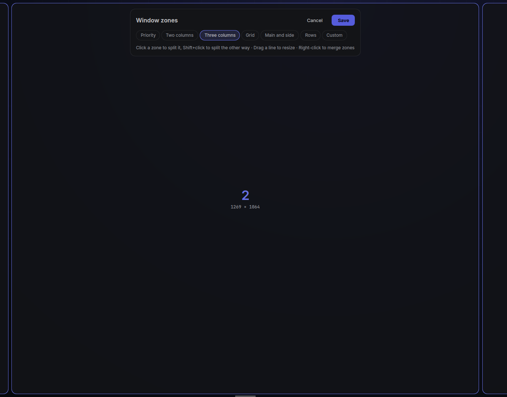
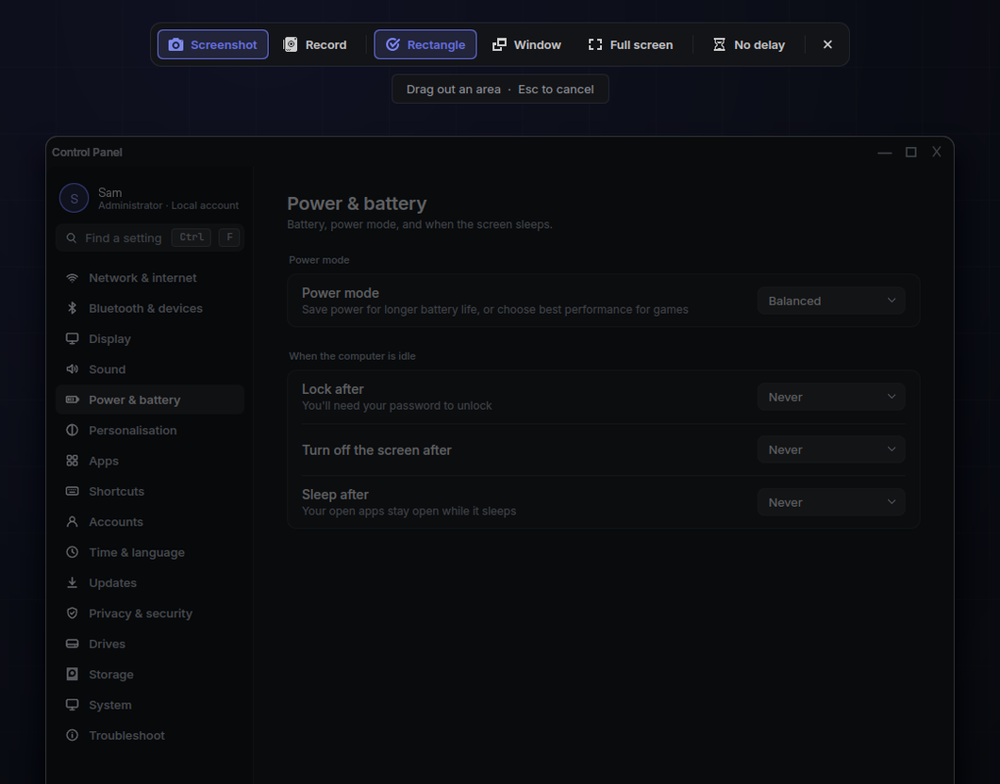
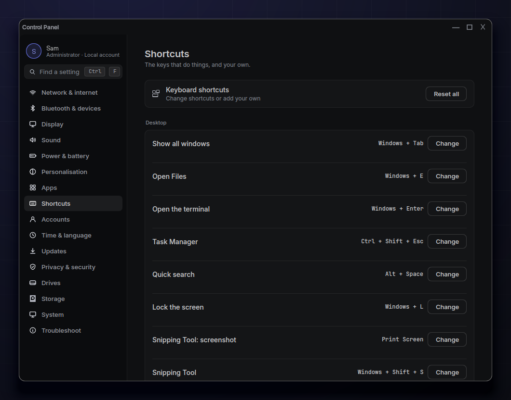

# Graphite

**A calm, familiar desktop for Linux, made for people who know Windows.**

Graphite turns Arch Linux into a desktop that feels like home from the first minute. There's a
Start menu, a taskbar, a Control Panel, Alt+Tab, Task Manager and the Snipping Tool, all where
you'd look for them. It installs from a USB stick in a few friendly screens, keeps itself up to
date, and runs your Steam games.

<p align="center">
  
</p>

## Why you might like it

- **Nothing new to learn.** The Windows key opens Start. Ctrl+Shift+Esc opens Task Manager.
  Print takes a screenshot. Settings live in one Control Panel, laid out like Windows Settings.
- **No terminal needed.** Updates, apps, drives, accounts and security all have a page with
  buttons. You never have to type a command.
- **Quick and up to date.** Underneath is Arch Linux, a fast version of Linux that always has
  the newest apps and drivers.
- **Ready for games.** One button sets up Steam, with Proton to run Windows games.

## Highlights

<table>
  <tr>
    <td width="50%" valign="top">
      
      <h3>Make it yours</h3>
      Deep, quiet colours with an indigo accent, or blue, mint, amber or rose. A floating
      taskbar, frosted-glass blur and a wallpaper that glows softly. Turn the blur off, or make
      animations quicker or calmer.
    </td>
    <td width="50%" valign="top">
      
      <h3>Updates in one click</h3>
      Graphite checks every few hours and tells you once. One button updates everything: the
      system, your apps from Flathub (Linux's big app store) and the AUR (apps packaged by Arch's
      community), and Graphite itself. Or let it update by itself each day.
    </td>
  </tr>
  <tr>
    <td width="50%" valign="top">
      
      <h3>Get apps</h3>
      Search and install with one click. Apps come from Arch's own packages, from Flathub, or
      straight from a project on GitHub, where Graphite tells you what it will install, and
      from whom, before it does. Downloaded a <code>.deb</code> or an AppImage? Open it and it
      installs.
    </td>
    <td width="50%" valign="top">
      
      <h3>Snap windows into zones</h3>
      Hold Shift while you drag a window by its title bar, and zones appear. Let go over one and
      the window fills it. Pick a layout or draw your own, as with PowerToys' FancyZones.
    </td>
  </tr>
  <tr>
    <td width="50%" valign="top">
      
      <h3>Snipping Tool</h3>
      Press Print or Windows+Shift+S to grab an area, a window or the whole screen.
      Windows+Shift+R records a video instead. Either way it's copied, ready to paste into a chat
      or an email.
    </td>
    <td width="50%" valign="top">
      
      <h3>The keys you know</h3>
      Windows+E opens Files, Windows+L locks, Alt+Tab switches and Ctrl+Shift+Esc opens Task
      Manager. Don't like one? Change it, or add your own that open your favourite apps.
    </td>
  </tr>
</table>

## And there's more

- **Task Manager.** Ctrl+Shift+Esc, as ever. See your apps and what runs in the background, end
  a stuck app, and watch live graphs of the processor, memory, disks, network and graphics card.
- **See what fills your drives.** The Storage page shows each drive and the folders taking the
  most room, down to each Steam game. A clean-up wizard clears caches and leftovers, says what
  deleting each one costs, and reminds you once a week when there's a gigabyte to free.
- **A security check-up.** Every day or week, Graphite looks for known security holes, checks
  the firewall and what's open to the network, and can scan your downloads for malware. If
  something needs a look, you get a notification and a button that fixes it.
- **Windows remember where they were.** Apps reopen in the same place and size, even after a
  restart. Maximised and docked windows come back that way too.
- **Notifications lead somewhere.** Click one and the app it came from comes forward.
- **Games behave.** A full-screen game stays in front when you click back into it, and it
  can't snatch the keyboard back while you're in Discord. Steam games even run from exFAT
  drives, so a games drive you share with Windows just works.
- **Apps stay signed in.** Claude, VS Code, Chrome and other apps remember your sign-in after
  a restart, as Windows' Credential Manager does for them.
- **Sign in with a PIN**, or with your password. The sign-in and lock screens match the
  desktop.
- **Smooth scrolling.** One turn of the mouse wheel moves a proper distance in Graphite's own
  windows, gliding rather than jumping.
- **Plays well with Windows drives.** NTFS and exFAT drives connect with a click and stay
  connected after a restart. Even Windows' dynamic disks open.
- **Alt+Tab, Task view and window tabs.** Live previews of every window, desktops with
  Windows+Tab, and tabs made by dragging one window onto another.
- **It picks itself up.** If the taskbar ever stops, it comes back by itself in a few seconds.
  When memory runs out, one stuck process no longer takes its whole app down with it.

## Install

Graphite installs from a USB stick. **The installer erases the whole drive you choose, Windows
included**, so copy anything you want to keep first. Want to look around safely first? Try it in
a [virtual machine](#try-it-in-a-virtual-machine).

1. **Make the USB stick.** There's no ready-made download yet, so you build the image once, on
   any computer running Arch Linux (the virtual machine below works too):

   ```bash
   git clone https://github.com/CookieJarTools/Graphite.git
   sudo bash Graphite/linux/installer/build-iso.sh "$PWD/Graphite"
   ```

   Write the image it makes (`Graphite/linux/installer/out/graphite-<date>-x86_64.iso`, about
   1.6 GB) to a USB stick of 4 GB or more with [Rufus](https://rufus.ie) or
   [balenaEtcher](https://etcher.balena.io).
2. **If Windows uses BitLocker,** save its recovery key first (Settings › Privacy & security ›
   Device encryption).
3. **Start the computer from the stick.** Press the boot-menu key as it starts (often F12, F11,
   F8 or Esc) and pick the USB entry that says **UEFI**. If it won't start, turn off Secure Boot
   in the firmware settings (often Del or F2).
4. **Follow the screens.** Choose your region and keyboard, join your Wi-Fi, pick the drive, then
   your name and password, disk encryption, the look and any apps you'd like. It takes 10 to 30
   minutes.
5. **Restart,** and take the stick out once the screen goes dark. Graphite's sign-in screen is
   waiting.

From then on, Control Panel › Updates keeps everything up to date.

**Already running Arch Linux?** `linux/setup.sh` adds Graphite to the system you have. See
[How Graphite works](linux/README.md#run-it-on-your-own-arch-install).

### Try it in a virtual machine

On Windows, [`linux/vm/make-vm.ps1`](linux/vm/README.md) makes a VirtualBox virtual machine
that installs Arch Linux and Graphite by itself and starts straight into the desktop. A virtual
machine has no real graphics card, so it's slower, and it can't run games.

## What you need

- A 64-bit PC (Intel or AMD) that starts in UEFI mode. Almost every PC from the last ten years
  does.
- Graphics from NVIDIA (GeForce GTX 16 or RTX 20 series, or newer), AMD or Intel. The installer
  picks the right drivers.
- A drive you're happy to give to Graphite. 64 GB or more leaves room for apps; games need more.
- 8 GB of memory or more.
- An internet connection while installing, by Wi-Fi or a cable.
- A USB stick of 4 GB or more.

A few games can't run on Linux at all, because their anti-cheat refuses it: Valorant and League
of Legends, for example. Most of Steam runs well. Graphite is a young project, made and tested on
one gaming PC with an NVIDIA card, so other hardware has had less testing.

## Handy shortcuts

| Keys | What they do |
| --- | --- |
| Windows key | Start: apps, files, folders and settings |
| Alt+Space | Quick search |
| Alt+Tab | Switch windows |
| Windows+Tab | Task view: every window, and your desktops |
| Windows+Left, Right, Up | Snap to the left or right half, or maximise |
| Windows+E | Files |
| Windows+L | Lock |
| Print, or Windows+Shift+S | Snipping Tool |
| Windows+Shift+R | Record the screen (press again to stop) |
| Ctrl+Shift+Esc | Task Manager |

You can change any of them, or add your own, in Control Panel › Shortcuts.

## Learn more

- [How Graphite works](linux/README.md): every part, how it's built, and where it lives in the
  code.
- [The installer](linux/installer/README.md) and [the test virtual machine](linux/vm/README.md).
- [Graphite for Windows](docs/windows.md): where it all started, a shell for Windows 11 with the
  same launcher and taskbar.
